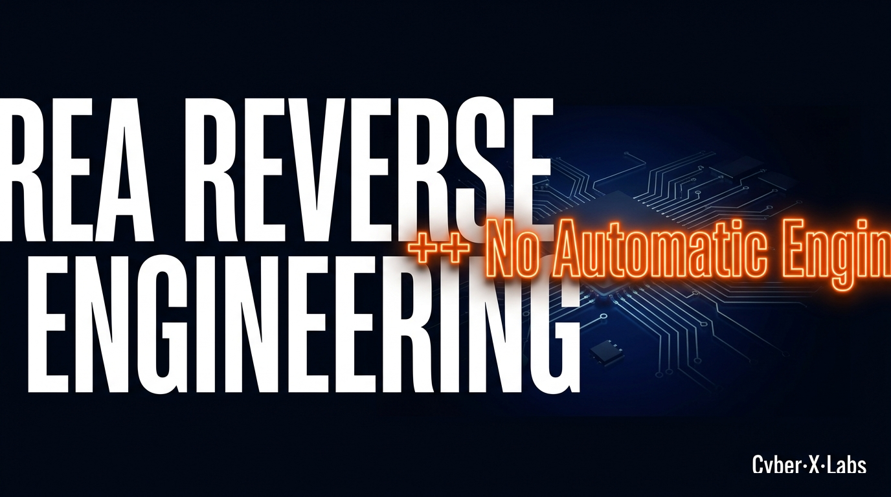
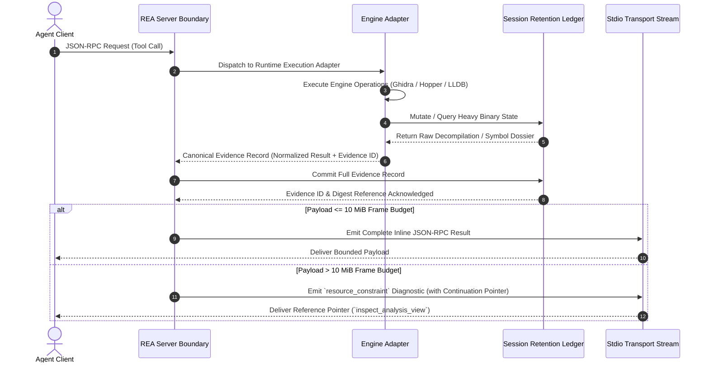
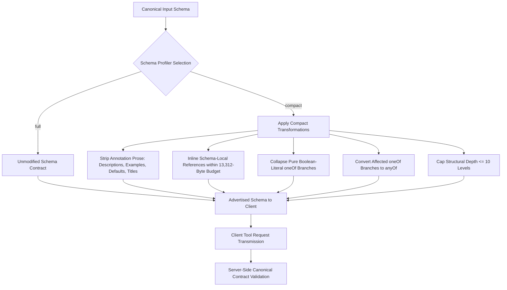

> 💬 **Slide Decks & Materials**: Welcome to join our community ([Discord](https://discord.gg/gZd3QZrwRe) / [Telegram](https://t.me/cyberxlab_community) / [WeChat](/wechat/)) to request the full 4K vector PDF slide decks.

---

### 1. The Crime Scene: Why the Status Quo Fails

#### The 496 KB Context Explosion & MSIX Virtualization Trap

Modern agentic integrations break down when static model constraints intersect with unmanaged tool catalog inflation and host operating system virtualization layers.

In agent execution environments like Claude Code integrated with non-first-party model endpoints (e.g., DeepSeek routed via an Anthropic-compatible `ANTHROPIC_BASE_URL`), tool search deferral is disabled automatically. When tool search is disabled, the client injects the complete tool schema inventory into every conversation turn. Within a full 172-tool Model Context Protocol (MCP) catalog, the un-optimized default schema payload measures approximately 496 KB (and ~290 KB in compact mode). Tokenized via modern byte-pair encodings, this single static tool injection consumes roughly 68,000 tokens under the `cl100k` tokenizer or approximately 120,000 tokens (~120k) under the `o200k` tokenizer before any user instructions, conversation history, or binary evidence are attached.

Because context compaction routines cannot prune active tool definitions from the window, the context window refills immediately following a compaction event. This triggers infinite autocompact thrashing, locking the agent into an inescapable loop of latency and operational overhead.

On Windows 11, host-level desktop integrations encounter silent failure modes due to MSIX package storage virtualization. When Claude Desktop is deployed as an MSIX package (Package Family Name: `Claude_pzs8sxrjxfjjc`, installed under `C:\Program Files\WindowsApps\Claude_<version>_x64__pzs8sxrjxfjjc`), the OS virtualizes file system access to `%APPDATA%`.

```
[Standard External Installer / Host Process]
       | Writes registration to host path:
       v
 %APPDATA%\Claude\claude_desktop_config.json
       x (Ignored by virtualized MSIX client once private copy exists)
       
[Claude Desktop MSIX Package (Claude_pzs8sxrjxfjjc)]
       | Reads private virtualized redirect:
       v
 %LOCALAPPDATA%\Packages\Claude_pzs8sxrjxfjjc\LocalCache\Roaming\Claude\claude_desktop_config.json
```

Once the MSIX application writes an internal setting, it reads exclusively from its package-private directory:
`%LOCALAPPDATA%\Packages\Claude_pzs8sxrjxfjjc\LocalCache\Roaming\Claude\claude_desktop_config.json`

Standard installation scripts or external CLI processes writing to `%APPDATA%\Claude\claude_desktop_config.json` modify a host file that the active client completely ignores. 

Crucially, child processes spawned from *within* Claude Desktop's integrated terminal or Code pane inherit this redirected virtualization view—even while reporting no explicit package identity. Running commands like `npm install -g` inside an integrated terminal silently writes global packages into `LocalCache\Roaming\npm`. These binaries remain completely invisible to ordinary host terminals, breaking external agent setups and dropping client registrations.

#### The Bankruptcy of Existing Workarounds

Standard operational workarounds fail when scaled to high-throughput reverse engineering (RE) pipelines:

* **Un-Buffered Stdio Framing Crashes**: Standard stdio JSON-RPC transport readers rely on fixed memory buffers. When an analysis engine materializes a native binary function dossier, symbol graph, or decompilation payload exceeding 10 MiB, raw transport readers fail or truncate the stream, severing the client connection.
* **Orphaned Process Corruption**: Naive subprocess execution lacks process group tracking or kernel-level Job Object encapsulation. When an agent or client cancels an operation or encounters a timeout, heavy child engines (such as headless Ghidra Java instances, LLDB debuggers, or Playwright Chromium processes) remain active in the background, locking file handles, exhausting host RAM, and corrupting system state.
* **Evidence Decoupling**: Naive context clearing attempts to recover token space by dropping conversation turns. However, wiping history severs vital cryptographic evidence links, structural parent-child relationships, and provenance metadata required to verify binary analysis conclusions.

#### First-Principles Thesis & Explicit Non-Goals

To resolve these systemic failures, REA establishes an evidence-retaining MCP bridge architecture. REA decouples execution engines (Ghidra, Hopper, LLDB, Playwright, GDB, Rizin) from the agent’s context window through deterministic session retention, client-side schema profiling, and zero-trust target sandboxing.

To maintain architectural determinism, REA explicitly enforces the following **Non-Goals**:

* **No Automatic Engine Failover**: REA *does not* automatically fall back to secondary analysis engines (e.g., switching from Ghidra to Hopper) upon runtime execution errors.
* **No License Bypassing**: REA *does not* bypass native binary license controls, software protections, or vendor entitlements.
* **No Direct Execution during Static Analysis**: REA *does not* execute untrusted target code directly during static JavaScript, .NET, or ASAR analysis.
* **No Synthesized Runtime Call Paths**: REA *does not* infer or forge un-observed runtime execution paths from ambiguous static call targets.

> **Maintainer Note: Why Core Maintainers Reject Automatic Engine Failover**
> Automatic engine failover hides deep semantic discrepancies between decompilers. Ghidra, Hopper, and IDA handle Objective-C message sends, C++ structure layouts, type recovery, and reference classifications differently. Automatically switching engines when a query fails silently injects subtle, conflicting assumptions into the model's reasoning chain. REA enforces strict, explicit provider selection: if an engine fails, REA returns typed error diagnostics, preserving model awareness of exact provider boundaries.

---

### 2. Under the Hood: System Topology & Dataflow

#### End-to-End System Topology

REA operates as an intermediate systems bridge separating the high-level Agent Client from low-level native reverse engineering engines, debuggers, and headless browsers. Communication between the Agent Client and REA occurs over a stdio JSON-RPC boundary.

When a request crosses the server boundary, REA routes execution to specialized runtime execution adapters:
1. **Ghidra Adapter**: Interfaces via an isolated Java bridge and temporary project state.
2. **Hopper Adapter**: Communicates through a local Python bridge and socket transport.
3. **LLDB Subprocess**: Spawns and supervises native debug processes via explicit process tracking.
4. **Playwright CDP Adapter**: Attaches to Electron or Chromium targets over loopback HTTP/CDP endpoints.
5. **GDB/Rizin Debug TTYs**: Manage interactive debug sessions bound to dedicated, verified TTY/PTY mounts.

#### Request Lifecycle Sequence



#### Core Abstraction Primitives: The Shift to Reference-Based Evidence Pagination

REA fundamentally shifts agentic architecture from **"Eager Text Serialization"** (flooding context windows with raw dump payloads) to **"Reference-Based Evidence Pagination"** (retaining full records out-of-band while passing immutable cryptographic pointers to the model). This is implemented through three core primitives:

##### 1. The Canonical Evidence Record
Every analysis operation generates a cryptographically identified, structured JSON payload containing normalized results, an immutable evidence identity, versioned execution profiles, and provenance markers:

```json
{
  "structuredContent": {
    "normalized_result": {
      "coverage": { "scope": "root", "status": "complete" },
      "procedure": "0x000112f0",
      "dossier": { "asm_lines": 142, "pseudocode_lines": 38 }
    },
    "evidence_id": "ev_8f3a9b2c1d4e5f6a7b8c9d0e1f2a3b4c5d6e7f8a9b0c1d2e3f4a5b6c7d8e9f0a",
    "analysis_profile": {
      "provider_id": "ghidra",
      "version": "12.1.4",
      "profile_digest": "sha256_e3b0c44298fc1c149afbf4c8996fb92427ae41e4649b934ca495991b7852b855"
    }
  },
  "_meta": {
    "provenance": {
      "untrusted_content": true,
      "source": "analysis_target"
    }
  }
}
```

##### 2. Session Retention Ledger & Views
To prevent large payloads from exhausting context space or breaking transports, full Evidence Records are stored in a session retention ledger. Clients receive a bounded summary payload alongside continuation pointers. Using `inspect_analysis_view`, clients query paginated subsections (e.g., pseudocode slices, basic blocks, or AST nodes) without re-running underlying engine analysis:

```json
{
  "name": "inspect_analysis_view",
  "arguments": {
    "source": {
      "kind": "retained-evidence",
      "evidence_id": "ev_8f3a9b2c1d4e5f6a7b8c9d0e1f2a3b4c5d6e7f8a9b0c1d2e3f4a5b6c7d8e9f0a"
    },
    "view": {
      "kind": "native",
      "facet": "pseudocode",
      "offset": 0,
      "limit": 64
    }
  }
}
```

##### 3. Process Supervision & OS TTY Ownership
REA tracks every launched child process using kernel primitives:
* **Windows**: Enforces lifetime ownership using native **Job Objects** and protected DACLs, ensuring automatic child termination upon parent process exit.
* **Linux/macOS**: Enforces process ownership via explicit PID tracking, process group encapsulation, and strict TTY device verification. For interactive debuggers (GDB / Rizin), REA inspects `/proc/<pid>/fd/1` and `/proc/<pid>/fd/2` on Linux to confirm device numbers and inodes match the caller-selected TTY mount (`inferior_tty`), preventing orphaned processes from hijacking host terminals or persisting silently.

| Resource Type | Tracking System | Reaping & Cleanup Trigger |
| :--- | :--- | :--- |
| **Child Processes** | Job Objects (Win) / PIDs & `/proc` (Linux) | Session Close / Client Cancellation / Parent Exit |
| **Memory Buffers** | 10 MiB Stdio Frame Budget | Immediate Payload Offloading to Ledger |
| **TTY Streams** | `/proc/<pid>/fd` Inode & Device Matching | Session Detach / Timeout / Process Exit |
| **Temporary Files** | Atomic Staging Paths & Clean Receipts | Session Close / Bundle Export Finalization |

---

### 3. Deep Mechanics & Minimal Code Primitives

#### Schema Profiling & Bounded Transport State Machine

To support strict client environments (such as Kimi Code / Moonshot API, which enforces a **13,312-byte per-tool schema size cap** and a **10-level JSON structural depth limit**), REA implements a client-side schema presentation pipeline controlled via `REA_MCP_INPUT_SCHEMA_PROFILE`:



##### Transport Budget Management
The stdio JSON-RPC transport maintains a hard limit of 10 MiB (`REA_MCP_MAX_RESPONSE_BYTES = 10485760`). When an engine generates an Evidence record exceeding this frame size:
1. The server traps the oversized payload prior to transport serialization.
2. The complete Evidence record is committed to the local session retention ledger.
3. The server constructs a `resource_constraint` JSON-RPC error response containing a continuation pointer:

```json
{
  "isError": true,
  "content": [{
    "type": "text",
    "text": "{\"error\":{\"code\":\"resource_constraint\",\"details\":{\"resource\":\"transport\",\"reported_limits\":{\"evidence_reference\":\"ev_8f3a9b2c1d4e5f6a7b8c9d0e1f2a3b4c5d6e7f8a9b0c1d2e3f4a5b6c7d8e9f0a\",\"continuation\":{\"name\":\"inspect_analysis_view\",\"arguments\":{\"source\":{\"kind\":\"retained-evidence\",\"evidence_id\":\"ev_8f3a9b2c1d4e5f6a7b8c9d0e1f2a3b4c5d6e7f8a9b0c1d2e3f4a5b6c7d8e9f0a\"},\"view\":{\"kind\":\"native\",\"facet\":\"pseudocode\",\"offset\":0,\"limit\":64}}}}}}}"
  }]
}
```

#### Production-Grade Code Primitive

The Model Context Protocol SDK enforces a default 60-second inactivity deadline. Sending progress tokens alone **does not** automatically extend client deadlines unless client-side timeout reset policies are configured. To prevent premature client timeouts during cold engine startup (~60s–160s), the client must explicitly pass `resetTimeoutOnProgress: true` alongside progress notifications, or bind an explicit `AbortSignal.timeout(totalBudgetMs)`.

The following TypeScript implementation demonstrates initiating binary analysis, managing timeouts, handling progress notifications, trapping client exceptions, and executing clean recovery:

```typescript
import { Client } from "@modelcontextprotocol/sdk/client/index.js";
import { StdioClientTransport } from "@modelcontextprotocol/sdk/client/stdio.js";

async function analyzeBinaryFunctionWithRecovery(
  client: Client,
  targetPath: string,
  procedureAddress: string
) {
  // 1. Initialize binary target with Ghidra provider
  await client.callTool({
    name: "open_binary",
    arguments: { path: targetPath, provider_id: "ghidra" }
  });

  const totalBudgetMs = 240000; // 240-second budget for cold Ghidra auto-analysis

  try {
    // 2. Request function analysis carrying resetTimeoutOnProgress and AbortSignal
    const result = await client.callTool(
      {
        name: "analyze_function",
        arguments: { procedure: procedureAddress }
      },
      {
        timeout: totalBudgetMs,
        resetTimeoutOnProgress: true, // Crucial: resets 60s SDK timer on progress updates
        signal: AbortSignal.timeout(totalBudgetMs),
        onprogress: (progressData) => {
          console.warn(`[Analysis Progress] Message: ${progressData.message}`);
        }
      }
    );

    return result;
  } catch (error: any) {
    console.error(`[Analysis Trapped or Timed Out]: ${error.message}`);

    // 3. Trapped Exception Recovery Routine:
    // Re-issuing open_binary alone DOES NOT perform a clean recovery.
    // We must execute close_binary to drain owned engine tasks and clear session state.
    console.warn("[Recovery Routine] Issuing close_binary to drain owned engine tasks...");
    const closeResult: any = await client.callTool({
      name: "close_binary",
      arguments: {}
    });

    // Check for cleanup_incomplete diagnostics
    if (closeResult.isError || closeResult?.content?.[0]?.text?.includes("cleanup_incomplete")) {
      throw new Error(`Fatal: Engine process cleanup incomplete: ${JSON.stringify(closeResult)}`);
    }

    // 4. Re-initialize target and re-attempt execution
    console.warn("[Recovery Routine] Re-opening target binary for retry...");
    await client.callTool({
      name: "open_binary",
      arguments: { path: targetPath, provider_id: "ghidra" }
    });

    return await client.callTool(
      {
        name: "analyze_function",
        arguments: { procedure: procedureAddress }
      },
      {
        timeout: 300000,
        resetTimeoutOnProgress: true,
        signal: AbortSignal.timeout(300000)
      }
    );
  }
}
```

---

### 4. Gotchas, Failure Modes & Architectural Taxes

#### Architectural Taxes: Operational Latency vs. Token Economics

The systems isolation provided by REA introduces operational latencies that must be balanced against token savings:

```
[Token Economics Tax vs. Operational Latency Tax]

Full Tool Catalog Injection (172 Tools):
  Payload Size: ~496 KB
  Token Overhead: ~120,000 tokens per turn
  Economic Tax: High recurring API token cost + autocompact thrashing

Compact Profile + Cold Engine Startup:
  Payload Size: ~290 KB (Compact profile)
  Startup Delay: ~64s (WSL2) to ~163s (Native Win x64)
  Warm Query Delay: ~19 ms
  Economic Benefit: Saves ~120k tokens per turn; offloads heavy evidence out-of-band
```

* **Cold Engine Startup Overhead**: Ghidra auto-analysis and bridge initialization require significant startup time. While the default startup timeout is set to 330,000 ms (330 seconds), real-world benchmarks demonstrate:
  * **WSL2 x64** (2 CPUs, 512 MiB Java heap, JDK 21, NTFS mount): **~64 seconds** cold start.
  * **Native Windows x64** (Ghidra 12.1.4, JDK 21, Node 22.19.0): **~163 seconds** cold start.
  * **Warm Subsequent Queries**: **~19 ms**.
* **IPC & Serialization Overhead**: Large structural graphs cannot be transmitted in single frame responses without blocking the event loop or exceeding transport limits. For example, Interface Builder document graphs (e.g., `XLD.app`, measuring 6.7 MB / ~2M tokens) or Mach-O symbol tables (e.g., `Electron Framework`, measuring 2.5 MB) must be queried using `detail: "summary"` followed by paginated reads via `inspect_analysis_view`.

#### Production Gotchas & Edge Cases

##### 1. Electron Active Capture Fuse Rejection
Executing active scenario captures (`capture-electron-scenario`) against production Electron binaries where the inspector fuse (`EnableNodeCliInspectArguments`) is explicitly disabled will fail. Instead of hanging until the 60-second startup deadline expires, REA inspects target fuse states prior to launch. It immediately throws an `AnalysisUnsupportedTargetError` carrying the `unsupported_target` error code.

*Remediation*: Switch to passive CDP inspection via `inspect_electron_page` or run against an unrestricted development binary with extracted application ASAR archives.

##### 2. Prompt Injection via Untrusted Target Content
Target binaries, decompiled strings, symbol maps, and render trees can contain embedded prompt injection payloads (e.g., text strings crafted to instruct an LLM to execute host commands). REA tags all output payloads containing target data with a metadata provenance marker:

```json
{
  "_meta": {
    "provenance": {
      "untrusted_content": true,
      "source": "analysis_target"
    }
  }
}
```

*Remediation*: Integration layers must parse `_meta.provenance.untrusted_content` and treat all returned symbols, decompiled pseudocode, and string tables strictly as data, suppressing execution flags for target-derived instructions.

##### 3. ASAR Integrity Contradictions
Commercial build pipelines commonly sign, strip, or modify native `.node` binaries inside `.asar.unpacked` directories *after* generating the `app.asar` header digest. Electron's native runtime loader intentionally skips unpacked companion hash verification, creating a direct contradiction between static archive headers and disk reality.

*Remediation*: Supply `integrity_policy=record-and-continue` during analysis or extraction execution. This isolates mismatched binaries as `integrity_contradictions` while allowing analysis of verified sibling files to proceed:

```bash
rea extract-artifact app.asar --integrity-policy record-and-continue
```

---

### 5. Adoption Playbook & Decision Tree

#### Objective Decision Tree

| Criterion | ✅ When to Adopt REA | ❌ When NOT to Use REA |
| :--- | :--- | :--- |
| **Execution Context** | Local security research, multi-target reverse engineering, interactive agent workflows. | Ephemeral cloud-sandbox environments lacking process control, TTY access, or local storage. |
| **Target Scope** | Multi-target reverse engineering (Native ELFs/PEs/Mach-O, Electron IPC, Android APKs, WASM). | Simple text searches across raw source code files where standard utilities (`grep`, `strings`) suffice. |
| **Evidence Policy** | Workflows requiring deterministic evidence retainment, audit trails, and non-destructive analysis. | Pipelines requiring automated bypass of commercial vendor DRM or license entitlements. |
| **IPC Requirements** | Local agent implementations managing native stdio/JSON-RPC processes. | Un-authenticated remote client environments incapable of managing local IPC lifecycle boundaries. |

#### Minimal Verified Quickstart

##### Step 1: Installation & Registration
Register REA with your target agent using the setup manager:

```bash
npx rea-agents setup
```

##### Step 2: Configuration Verification
Run `rea doctor` to validate client configuration paths, TTY availability, and environment profiles:

```bash
rea doctor --client claude_desktop
```

##### Step 3: Verification Run
Execute a local test analysis command to confirm end-to-end evidence generation and process cleanup:

```bash
npx -y rea-agents@latest analyze-javascript-application /path/to/target/app --json
```

---

### 6. Canonical References & Project Resources

* 🌐 **Project Homepage**: https://rea.tools/
* 💻 **Source Repository**: https://github.com/morluto/rea
* 📦 **NPM Package**: https://www.npmjs.com/package/rea-agents
